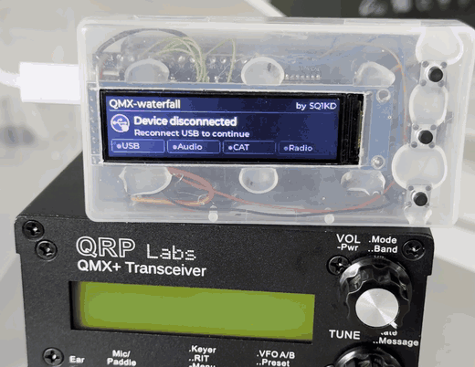
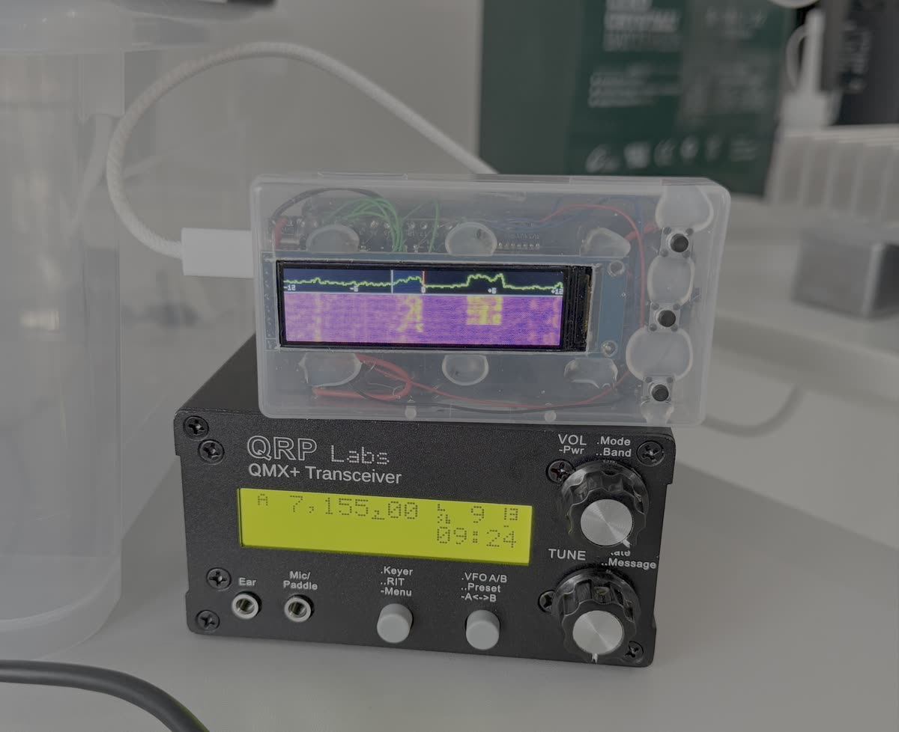
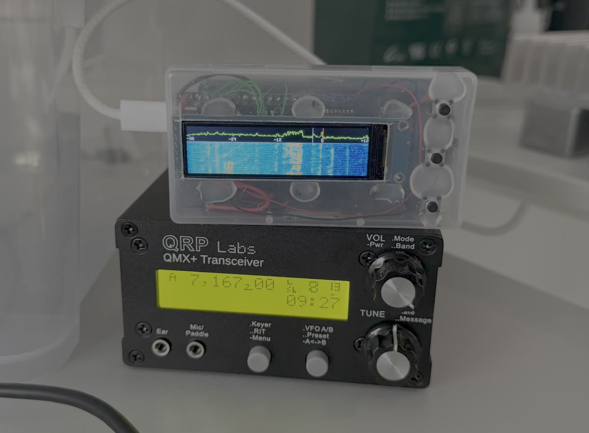
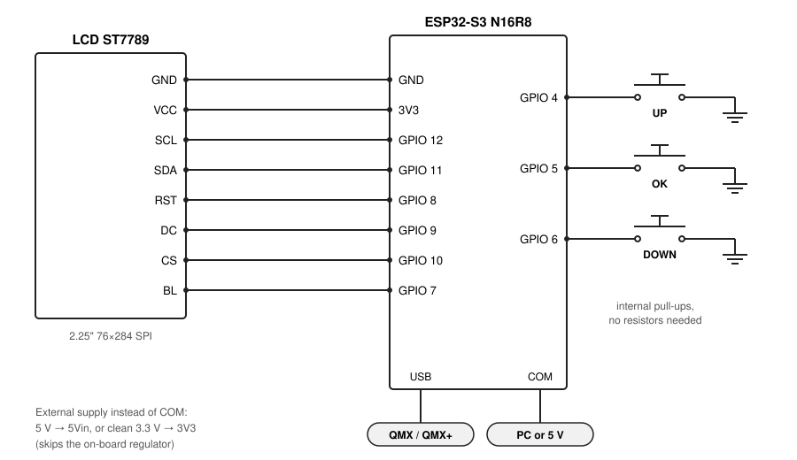
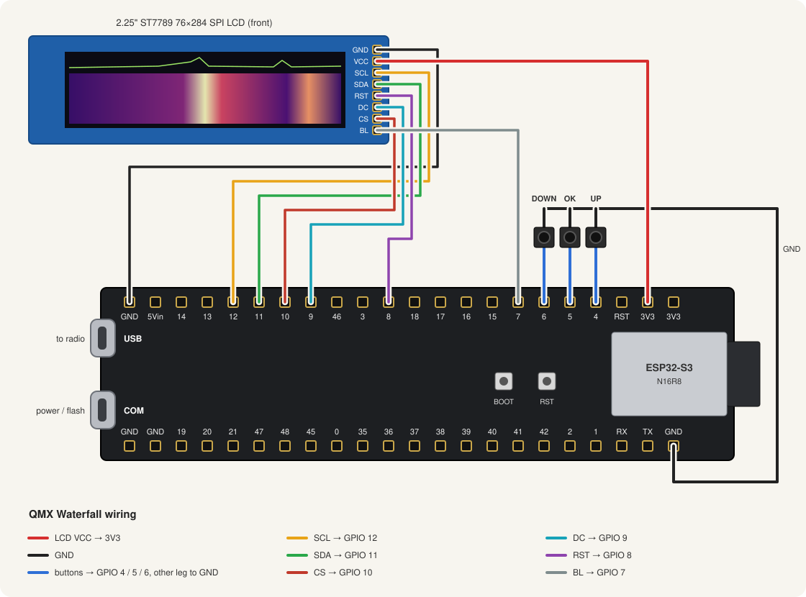
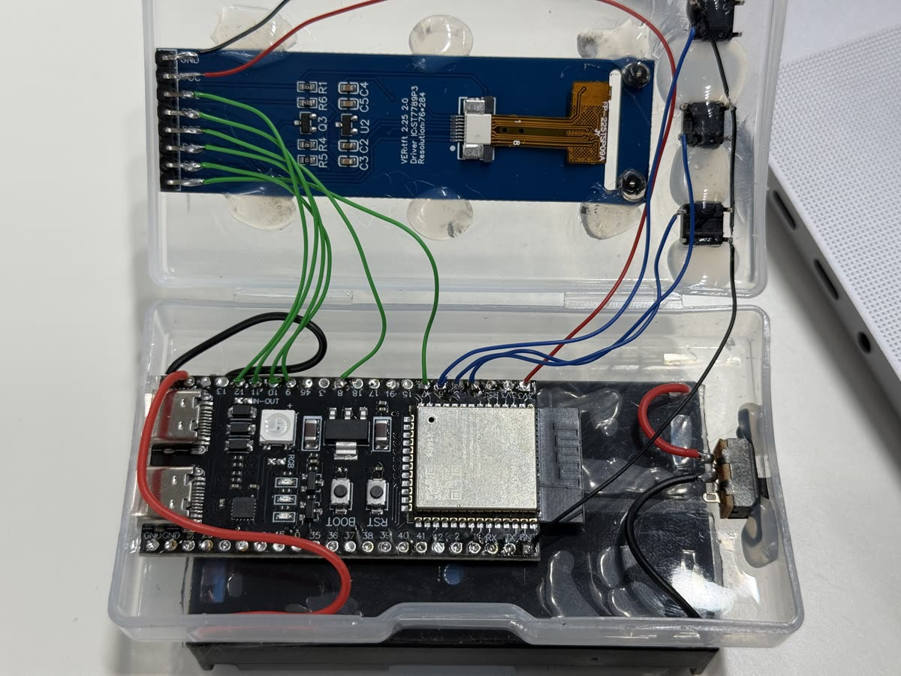

# QMX Waterfall

A small colour waterfall display for the QRP Labs QMX and QMX+. Plug the
radio into it with one USB cable and you get a live spectrum and waterfall
of everything around your frequency. No PC and no phone app are needed, and
the radio needs no extra configuration.

<p align="center">
  
</p>

## The story

This was a quick side project to see how it works, and it worked
surprisingly well. Then QRP power turned out not to be enough, a different
radio arrived, and rather than leave this on a shelf it is published here.
There are more powerful alternative projects out there now, and you may want
to check them out too.

**Project status: finished.** It runs stable and does everything I wanted,
so I do not plan to develop it further. Feel free to fork it and make it
your own.

That also explains the look of the prototype: a random box from the shelf,
wires, hot glue, and two 18650 cells in series for power, which works but
is far from efficient.

<p align="center">
  
  
</p>

## What it does

- **Live spectrum and waterfall** of the 48 kHz the radio streams over USB,
  or a zoomed 24 kHz centred on your frequency, shown on a 284×76 colour bar
  display.
- **Shows where you are listening.** A marker shows your receive
  frequency, and the current filter bandwidth is shaded. It follows mode
  changes, RIT and the CW pitch offset.
- **Works out of the box.** It switches the radio into I/Q mode by itself.
  If the radio drops I/Q mode (it does that when you leave its menu), the
  display turns it back on within a couple of seconds.
- **Easy to tune.** Three buttons adjust the brightness, contrast, speed,
  colours and more. Settings are kept after power-off.
- **Clear status.** While connecting, a row of indicators shows how far it
  got: USB, Audio, CAT, Radio, IQ, Spectrum. If something fails, you can
  see where.
- **English and Polish** user interface.

Tested on a **QMX+** (firmware 1_04_010). The QMX runs the same firmware and
should work the same way.

## What you need

| Part | Notes |
| --- | --- |
| ESP32-S3 board, **N16R8** (16 MB flash, 8 MB PSRAM), two USB-C ports | Sold as "ESP32-S3 N16R8", a DevKitC-style board with ports marked **USB** and **COM** (black or purple, sometimes "AI-S3" on the back). Boards without PSRAM also work, just a bit slower. |
| 2.25" ST7789 TFT LCD, **76×284**, SPI | Sold as "2.25 inch TFT LCD ST7789 76*284". 8-pin module: GND, VCC, SCL, SDA, RST, DC, CS, BL. |
| 3 push buttons | Up, OK, Down. Normally open, any small tactile switch. |
| Wires, a USB-C cable for the radio | Optionally a case. |

## Wiring

There is not much to it: the display goes to six GPIO pins plus power, and
each button connects a GPIO pin to GND. **No resistors are needed**; the
firmware turns on the internal pull-ups.



The same thing on the real parts, with the board lying the way it sits in
the prototype (ports on the left). All the pins used are on one header:



| Display pin | ESP32-S3 |
| --- | --- |
| GND | GND |
| VCC | 3V3 |
| SCL (CLK) | GPIO 12 |
| SDA (MOSI) | GPIO 11 |
| RES (RST) | GPIO 8 |
| DC | GPIO 9 |
| CS | GPIO 10 |
| BLK (backlight) | GPIO 7 |

| Button | ESP32-S3 | Other leg |
| --- | --- | --- |
| Up | GPIO 4 | GND |
| OK | GPIO 5 | GND |
| Down | GPIO 6 | GND |

### USB and power

The board has two USB-C ports, and they are not the same:

- **The radio goes into the port marked USB.** It is the ESP32-S3's native
  USB, the only one that can act as a USB host. The radio does not work on
  the other port.
- **The port marked COM** is for power, or for flashing the firmware from a
  computer.

You can also power it from an external supply instead of a USB port:

- **5 V** into the board's 5V pin. It goes through the on-board regulator,
  just like USB power.
- **3.3 V** straight into the 3V3 pin. This skips the on-board regulator, so
  the board uses less power. The supply must be a clean, regulated 3.3 V,
  because nothing on the board protects you from more.

<p align="center">
  
</p>

## Installing the firmware

Download the files for your board from the
[Releases](../../releases) page. There are two images:

| File | When to use | Flash at |
| --- | --- | --- |
| `qmx-waterfall-<board>-<version>-factory.bin` | **First install.** Erases the saved settings. | `0x0` |
| `qmx-waterfall-<board>-<version>-app.bin` | **Updating** an existing install. Keeps your settings. | `0x10000` |

The `.sha256` file holds checksums for both.

Connect the board to your computer with the **COM** port and flash it with [esptool](https://docs.espressif.com/projects/esptool/):

```shell
# first install
esptool -b 460800 --chip esp32s3 write-flash 0x0 qmx-waterfall-n16r8-v0.1.0-factory.bin

# update, keeps settings
esptool -b 460800 --chip esp32s3 write-flash 0x10000 qmx-waterfall-n16r8-v0.1.0-app.bin
```

If esptool cannot connect, hold the BOOT button, tap RESET, then release
BOOT and try again.

## First power-on

With nothing connected, the display shows **Waiting for device**. Plug the
radio into the native USB port and turn it on. A row of indicators lights up
one by one:

| Indicator | What it means |
| --- | --- |
| **USB** | The radio was found on USB. |
| **Audio** | The radio's USB sound card is set up (48 kHz, 24-bit, stereo). |
| **CAT** | The control link answers commands. |
| **Radio** | The radio reported its firmware version (`?` if it did not answer; that is fine). |
| **IQ** | I/Q mode is on. |
| **Spectrum** | The first picture is ready. The indicators then disappear and the waterfall starts. |

If one indicator stays red, the problem is at that step. **Connection
problem** means the radio stopped answering; unplug and replug it.
**Device disconnected** means the cable came out or the radio turned off.

## Using it

Startup, the settings menu and tuning around, about one minute:

https://github.com/user-attachments/assets/908b3b28-26e4-462d-a7e0-b70966c606db

### Buttons

- **Any button** opens the settings menu.
- **OK** moves to the next setting.
- **Up / Down** change the value. Hold to repeat.
- **Hold OK** (about ¾ s) closes the menu.

Every change applies immediately and is saved automatically.

### Settings

| Setting | What it does | Default |
| --- | --- | --- |
| **Level** | Raises or lowers everything on screen. Turn it up if the waterfall is too dark, down if it is too bright. Try this first. | 0 dB |
| **Low** | The signal strength that is drawn as the darkest colour. Raise it to hide the noise and leave only real signals. | −140 dB |
| **High** | The signal strength that is drawn as the brightest colour. Lower it to make weak signals stand out; raise it if strong ones all look the same. | 10 dB |
| **Gamma** | How colours are spread between Low and High. Below 1 shows more detail in weak signals; above 1 makes strong signals pop and darkens the background. | 1.00 |
| **Span** | **Full** shows all 48 kHz the radio sends. The radio's IF sits 12 kHz above your frequency, so this covers 36 kHz below to 12 kHz above it, and your frequency is off-centre. **IF centred** puts your frequency in the middle and shows ±12 kHz (24 kHz), with twice the detail. | Full |
| **Speed** | How fast the waterfall scrolls. Slow keeps a longer history on screen; fast shows short CW dits clearly. | 5 |
| **Palette** | The colour scheme: Turbo, Gray, Inferno, Viridis, Magma, Plasma, Blue Hot. | Magma |
| **Display** | The line graph above the waterfall: **Trace** (live), **Trace+peak** (live plus slowly falling peaks), **Peak** (peaks only), **Off** (more room for the waterfall). | Trace+peak |
| **CW pitch** | Set this to the same CW pitch (sidetone) as the radio, so the marker sits exactly on the signal you hear. | 700 Hz |
| **Language** | English or Polski. | English |

**Quick start:** if the picture is mostly one colour, adjust **Level** first,
then **Low** and **High**. Leave **Gamma** at 1 unless you want fine tuning.

## Good to know

- **Leaving the radio's menu switches I/Q mode off.** That is how the
  radio firmware works. The display notices within about two seconds and
  turns it back on. During that time the waterfall may show a short flash
  of audio instead of I/Q, which is then cleared.
- **The display never uses the radio's "auto information" mode** (`AI1;`).
  On firmware 1_04_010, auto information together with I/Q mode freezes
  the radio as soon as you open its menu, and only a power cycle helps. See
  [CAT details](#cat-link-details) below.
- **Some radios do not answer the first USB requests** after power-on. The
  firmware retries instead of giving up, so the radio may take a second or
  two to appear.

## Building from source

The toolchain is managed by [mise](https://mise.jdx.dev). It installs
ESP-IDF v6.1 into the project's `.idf/` folder, so you do not need an
existing ESP-IDF install.

```shell
mise trust
mise bootstrap                                  # one-time: ESP-IDF, compilers, Python env
mise run build
ESPPORT=/dev/cu.usbmodem1101 mise run flash     # leave out ESPPORT to auto-detect
ESPPORT=/dev/cu.usbmodem1101 mise run monitor
mise run test                                   # host tests, no board needed
mise run release                                # images into dist/
```

<details>
<summary><b>Developer notes</b>: tasks, board profiles, releases, CAT and dependencies</summary>

### Tasks

| Task | Does |
| --- | --- |
| `bootstrap` | provision ESP-IDF, toolchains, venv, submodules |
| `deps` | re-resolve managed components into `dependencies.lock` |
| `build`, `flash`, `monitor`, `menuconfig`, `clean` | the selected board |
| `idf -- <args>` | any other `idf.py` command for the selected board (e.g. `size`) |
| `release` | build + verify the profile + write images to `dist/` |
| `version` | the version string used in artifact names |
| `test` | host-only suite (`test/run.sh`, ASan/UBSan); no ESP-IDF or board |

Layout: `tasks/setup.toml` (bootstrap, deps, the hidden `vendor-patches` that
`idf` depends on), `tasks/build.toml` (idf.py wrappers), `tasks/release.toml`
(release, version), `tasks/idf.sh` (board selection and ESP-IDF activation),
and `test` in `mise.toml`.

### Bootstrap

`mise bootstrap` installs the tools pinned in `mise.toml` and runs the
`bootstrap` task. The task clones ESP-IDF v6.1 into `.idf/esp-idf` (or
checks out that ref if the directory is at another version). `IDF_PATH` from
your shell is ignored, so local and CI builds use the same tree. It then:

1. installs the compilers for every `CONFIG_IDF_TARGET` used under `boards/`
   with `idf_tools.py install --targets=...` (no `install.sh`, no EIM;
   toolchains land in `IDF_TOOLS_PATH`, by default `~/.espressif/tools`)
2. creates the Python environment with `uv` at `.idf/venv` and installs
   IDF's `requirements.core.txt` against IDF's constraints file
3. syncs the `vendor/esp-usb` submodule and applies the patches from
   `patches/`

Bootstrap does not modify tracked files: managed components are fetched by
the first build from the committed `dependencies.lock`, and re-resolving
them is a deliberate `mise run deps`. Re-running `mise bootstrap` is safe.

### Board profiles

A build always targets one profile: a directory under `boards/` holding a
`sdkconfig.defaults` with the hardware (`CONFIG_IDF_TARGET`, flash, PSRAM,
panel and button pins). There is no other board metadata.

`mise run idf -- <idf.py args...>` (`tasks/idf.sh`) is the one entry point
to `idf.py`; every other task wraps it. For the board in `QMX_BOARD` it runs

```
-B build/<id>
-D SDKCONFIG=build/<id>/sdkconfig
-D SDKCONFIG_DEFAULTS=sdkconfig.defaults;boards/<id>/sdkconfig.defaults
```

so each profile gets its own build directory and generated `sdkconfig`. The
project-root `sdkconfig` is not read; `sdkconfig.defaults` is the source of
truth.

- The default board is set in `mise.toml` (`QMX_BOARD`); `QMX_BOARD=<id>` in
  the shell selects another for any task.
- Adding a board: copy `boards/n16r8`, set `CONFIG_IDF_TARGET` and the
  hardware, and add it to the `firmware` matrix in `.github/workflows/ci.yml`
  once its image is verified. Only boards in that matrix are built by CI and
  published.
- The panel resolution is fixed in code (`main/ui/geometry.h`); a different
  panel size needs layout work, not just a new profile.
- PSRAM is optional at runtime: without it the display falls back to a
  partial internal draw buffer (`CONFIG_SPIRAM_IGNORE_NOTFOUND`).
- GPIO 0 (BOOT, `CONFIG_APP_QUIT_PIN`) stops the app cleanly; a power cycle
  restarts it.

`mise run release` also verifies that every line of the profile's
`sdkconfig.defaults` reached `build/<id>/sdkconfig`, so a Kconfig dependency
cannot silently override the hardware.

To change the configuration, edit `build/<id>/sdkconfig` with
`mise run menuconfig`, then fold the change back into the committed
defaults. `idf.py save-defconfig` always writes `sdkconfig.defaults` in the
project root, so split its output: software settings stay in
`sdkconfig.defaults`, hardware settings go to `boards/<id>/sdkconfig.defaults`.
Rebuild from scratch (`mise run clean`) to confirm a clean clone produces
the intended config.

### Versioning and releases

The release is the git tag; there is no version-bump automation.
`mise run version` prints `git describe` for the nearest `vX.Y.Z` tag
(`v0.1.0`, `v0.1.0-3-gabc1234`, plus `-dirty` for uncommitted parent-repo
changes; the vendored submodule patches do not count), and that string names
the artifacts. A tag build must produce exactly the tag name, which CI
enforces.

CI builds every board in its matrix on every push; pushing a `vX.Y.Z` tag
also publishes the images and checksums as a GitHub release. Between tags,
`mise run release` produces `-<commit>`/`-dirty` images for testing that are
never published.

### CAT link details

The radio exposes one USB CDC port. `main/cat/service.c` owns the link: a
single-command-at-a-time state machine (150 ms between commands, 700 ms
timeout) that publishes state through `cat_service_get_status()`. The
command table and reply dispatch live in `main/cat/commands.c`, IQ-mode
polling and recovery in `main/cat/iq.c`.

| Command | When | Notes |
|---|---|---|
| `Q9;` | connect, then every 2 s while `IQ_ACTIVE` | IQ mode get/health |
| `Q91;` | when IQ is missing or lost | IQ mode on; the set has no reply |
| `VN;` | once per connection, during `PROBE` | informational; silent/unsupported radio is not a fault |
| `IF;` | every `poll_period_ms` (1 s) | mode, RIT, TX/RX |
| `FW;` | 250 ms after a mode change, and after IQ recovery | filter bandwidth |

Only one response is ever outstanding. `VN;` and the `Q9;` health poll are
optional: a timeout reschedules rather than escalating to
`DEGRADED`/`FAULT`, so a radio busy in its configuration menu cannot trip
the link-fault path.

**`AI1;` is intentionally not used.** Measurements on firmware 1_04_010
(2026-11-01):

| `AI1` | IQ mode | Menu entered | Result |
|---|---|---|---|
| on | off | yes | fine |
| on | on | no | fine (120 s, heartbeats exactly 1.500 s) |
| on | on | **yes** | **radio freezes in ~1 s**, needs power cycle (3/3 runs) |
| off | on | yes | fine |

Closing or reopening the CDC port with `AI1` enabled is harmless, and an
active USB audio host does not change the outcome. Do not reintroduce it
without re-testing this exact combination on the target firmware. `AI2;` is
accepted but emits nothing; `AI3;` emits the same frames as `AI1`.

**IQ auto-recovery.** IQ mode is session-only on the radio and is cleared
when the operator leaves the configuration menu. `IQ_ACTIVE` polls `Q9;`
every 2 s:

1. A reply of `0` increments `iq_drops`, sets `iq_recovering` and enters
   `IQ_ENABLING`.
2. `IQ_ENABLING` sends `Q91;` (no reply), then `IQ_VERIFY` reads `Q9;`.
3. A reply of `1` increments `iq_reenables`, schedules an `FW;` refresh,
   requests a waterfall/spectrum history reset and returns to `IQ_ACTIVE`.
4. A reply of `0` retries after 1 s (three fast attempts), then backs off
   2/4/8 s up to a 10 s cap, indefinitely. Health-poll timeouts do not count
   as link faults.

**Startup checklist.** `main/display/status.c` renders the stage rail while
connecting; badges are driven from the connection callbacks and the CAT
status callback (USB: UAC connect; Audio: alt-parameter scan; CAT: CDC open,
then first `Q9;`; Radio: `VN;`; IQ: `IQ_VERIFY`; Spectrum: first frame).
`display_show_status()` resets it for the next connection.

### Dependencies

- ESP-IDF `v6.1` in `.idf/esp-idf`, provisioned by `mise bootstrap`
- ESP-IDF managed components from `components.espressif.com`, locked in
  `dependencies.lock`
- esp-usb (USB host library + UAC driver) as the `vendor/esp-usb` git
  submodule, pinned to `2e2032b` (esp-usb `master`, host `usb` 1.6.0,
  `usb_host_uac` 1.5.0) and resolved through `main/idf_component.yml`
  (`espressif/usb` and `espressif/usb_host_uac` point into the submodule)

Fixes on top of esp-usb live in `patches/` and are applied by the hidden
`vendor-patches` task, a dependency of every `mise run idf` call;
re-running is a no-op.

- `0001-usb-host-retry-short-dev-desc.patch`: the enumerator re-issues the
  short `GET_DESCRIPTOR` after a zero-length or truncated response instead
  of cancelling enumeration, for up to 2.5 s. The QMX answers the first
  descriptor requests with 0 then 2 bytes after USB power/reset, so the
  stock enumerator disabled the root port and no connect event reached the
  app.

To update esp-usb:

1. `git -C vendor/esp-usb fetch origin && git -C vendor/esp-usb checkout --detach <commit>`
2. Update the pin above.
3. `mise run vendor-patches`; if the patch no longer applies, rebase it
   instead of dropping it.
4. `mise run deps`, `mise run build`, then unplug/replug regression checks.

</details>

## License

[MIT](LICENSE)
